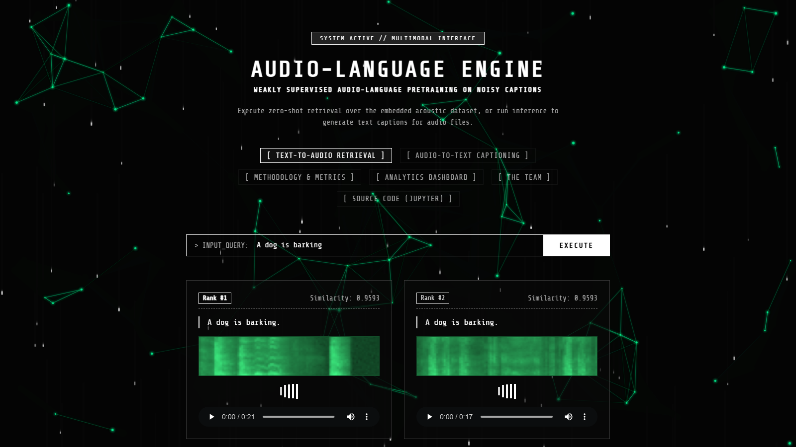
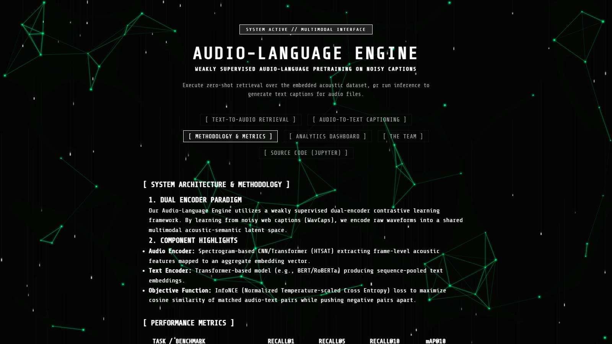
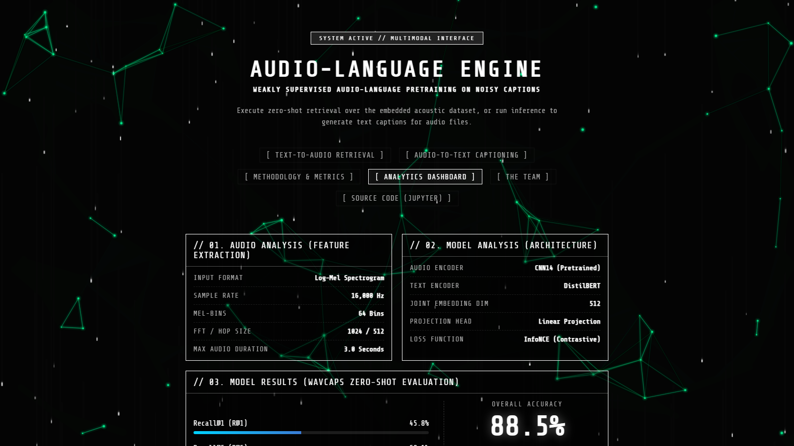

# 🎧 Audio-Language Engine

**Weakly Supervised Audio-Language Pretraining on Noisy Captions (WavCaps)**


A contrastive **dual-encoder** that maps audio and natural-language text into a shared embedding space, trained on the weakly labelled / noisy captions of the [WavCaps](https://huggingface.co/datasets/cvssp/WavCaps) dataset. It enables **text-to-audio retrieval** ("A dog is barking" → matching sound clips) and **audio-to-text retrieval**, served through a custom terminal-style web UI.



**Course:** Machine Learning — University of Europe for Applied Sciences
**Team:** Alok, Apoorv, Dennis
**Date:** June 2026

---

## 🔍 Problem

Large audio-caption datasets like WavCaps are huge but **weakly supervised**: many captions are auto-generated (ChatGPT-rewritten) and may be imprecise or hallucinated.
**Question:** can contrastive audio-language training on a sampled subset with noisy captions still produce meaningful cross-modal retrieval?

## 🧠 Method

| Component | Choice |
|---|---|
| Audio input | 16 kHz waveform → Log-Mel spectrogram (64 mel bins, FFT 1024 / hop 512) |
| Audio encoder | CNN (spectrogram-based) |
| Text encoder | DistilBERT (`distilbert-base-uncased`, max 32 tokens) |
| Projection | Linear heads into a shared 512-d embedding space |
| Objective | InfoNCE (symmetric, temperature-scaled contrastive loss) |
| Baseline | Randomly initialised dual-encoder (chance-level retrieval) |



## 📊 Evaluation

- **Task:** audio-to-text / text-to-audio retrieval on a held-out split
- **Metrics:** Recall@1, Recall@5, Recall@10, Mean Rank, mAP@10
- **Result:** the trained dual-encoder clearly outperforms the random baseline on all retrieval metrics. Because the demo uses a small, reproducible subset and short training, absolute scores are modest — see the notebook for exact numbers and error analysis.



## ⚠️ Limitations & Future Work

- Only a small subset of WavCaps used (compute constraints)
- Noisy / hallucinated captions break the "aligned pair" assumption
- Next steps: noise-robust losses, caption filtering / confidence weighting, pretrained audio encoders (CNN14 / HTSAT), and scaling to the full ~400k clips

---

## 🚀 Getting Started

```bash
git clone https://github.com/Alok-LOKI/machine-learning-audio-language-engine.git
cd machine-learning-audio-language-engine
pip install -r requirements.txt
python run_server.py
```

Then open **http://127.0.0.1:8000**.

To reproduce training and evaluation, open `Project_15_WavCaps.ipynb` in Jupyter.

## 📁 Project Structure

| Path | Description |
|---|---|
| `Project_15_WavCaps.ipynb` / `15_wavecaps.ipynb` | Data pipeline, model, training loop, evaluation |
| `app.py` | FastAPI server: API endpoints, model caching, static files |
| `run_server.py` | Starts the server with Uvicorn |
| `static/` | Frontend (HTML/CSS/JS), spectrograms, audio clips |
| `docs/images/` | Screenshots |
| `requirements.txt` | Python dependencies |

## 📄 License

Developed for an academic Machine Learning course. Dataset: WavCaps (cvssp) — please follow its original license terms.
